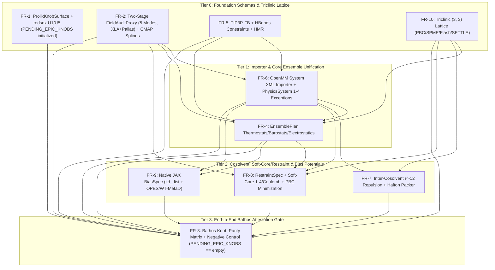

# EPIC: Control-Knob Governance (redsox + bathos) & naurmalade Feature Parity

## Goal

Establish a mathematically verifiable, zero-silent-drop governance contract over all simulation control knobs across OpenMM, kUPS, naurmalade, and Prolix's Full-Potential Pallas Kernel Suite (`use_pallas`, `use_pallas_pme`, `gb_use_neighbor_list`), paired with full physics and topology parity for naurmalade production workflows (multi-component cosolvents, custom restraint/soft-core/repulsive/biasing potentials, and non-cubic triclinic periodic boxes). Currently, Prolix exhibits a split-brain API where physics kernels exist in prolix.physics (PhysicsSystem in src/prolix/physics/system.py) while the primary user-facing entrypoints (MolecularBundle in src/prolix/types/bundles.py, EnsemblePlan in src/prolix/api/ensemble_plan.py, and SimulationSpec in src/prolix/simulate.py) either omit those knobs (evidence:prolix:01M5WZ75RY93XDA93GGSSYYSDN) or silently drop populated fields during conversion (evidence:prolix:01M5WZ66M279GZF8HX3AAEKRS4, evidence:prolix:01M5WZT8BB1T1S87JHE0KBHXGH). This Epic establishes a two-tier governance harness combining redsox (Tier B consumer-only static AST reachability U1 + vendor superset U5) and FieldAuditProxy + bathos (Tier A two-stage mode-covering runtime tracing consumption + numerical parity claims with a synthetic instrument-sensitivity negative control), and closes all 10 control-knob and feature gaps required to run naurmalade cosolvent, soft-core, enhanced-sampling, and triclinic-box campaigns end-to-end on Prolix while merging cleanly with the parallel Pallas kernel and propagator work on `feat/phase3-evidence-and-kups-261026`.

## Non-goals

- Full C++ PLUMED subprocess/socket coupling (plumed_script_path external C++ plugin execution) is out of scope; Prolix implements native differentiable JAX collective variables and bias potentials (BiasSpec and BiasState) so forces remain on-device without PCIe host round-trips or jax.grad breaks.
- Anisotropic or full triclinic cell-angle Monte Carlo barostat moves (MonteCarloAnisotropicBarostat / MonteCarloMembraneBarostat) are out of scope for this Epic (anisotropic=True raises an explicit tracked NotImplementedError in the Bathos knob-parity matrix); isotropic scaling of triclinic lattice matrices ($A' = s^{1/3} A$) is supported.
- Polarizable AMOEBA and Drude force fields are out of scope and explicitly tracked as unsupported in ProlixKnobSurface.

## Functional requirements

- FR-1: (redsox Tier B Static Governance, Zero-Cycle Canonical ProlixKnobSurface & Consumer-Only U1 Reachability) Define `src/prolix/physics/knob_surface.py` (`ProlixKnobSurface` `@dataclass(frozen=True)` unifying all `SimulationSpec`, `PhysicsSpec`, `NonbondedConfig`, `NeighborListConfig`, `EnsemblePlan`, `RestraintSpec`, `LambdaSchedule`, `BiasSpec`, and full-potential Pallas dispatch knobs `use_pallas: bool | None = None`, `use_pallas_pme: bool | None = None`, `gb_use_neighbor_list: bool = False` with explicit unit/alias metadata, `DOCUMENTED_INERT_KNOBS = frozenset({"safety_factor", "max_exclusions", "on_overflow"})`, and the staged `PENDING_EPIC_KNOBS` allowlist) as a strict zero-cycle leaf module importing only Python stdlib (`dataclasses`, `typing`, `enum`) and `prolix.typing` (verified by `tests/test_import_architecture.py` with zero lazy-import allowlist additions). Create a workspace `redsox.toml` (`target_package = "prolix"`, `target_source_root = "src/prolix"`, `target_dataclasses = ["prolix.physics.knob_surface.ProlixKnobSurface", "prolix.simulate.SimulationSpec", "prolix.physics.spec.PhysicsSpec", "prolix.physics.nonbonded_config.NonbondedConfig", "prolix.physics.nonbonded_config.NeighborListConfig"]`, `vendor_source_root`, `vendor_reference_classes` listing exact naurmalade, OpenMM, and kUPS reference classes, `[superset_alias_map]` mapping vendor field names onto canonical Prolix knob names, and `sibling_parity_governed = false`). Add a static governance test (`tests/physics/test_redsox_knob_governance.py`) that: (1) runs redsox U1 (`check_reachability`) across each underlying Prolix config dataclass (`SimulationSpec`, `PhysicsSpec`, `NonbondedConfig`, `NeighborListConfig`, `RestraintSpec`, `LambdaSchedule`, `BiasSpec`) with `consumer_paths` strictly limited to downstream kernel and runtime API modules (`src/prolix/physics/`, `src/prolix/api/bundle_md.py`, `src/prolix/api/ensemble_plan.py`, `src/prolix/batched_energy.py`, `src/prolix/batched_simulate.py`, `src/prolix/pallas_kernels.py`) and explicitly excluding config declaration modules (`knob_surface.py`, `nonbonded_config.py`, `spec.py`, `simulate.py`) so `__post_init__` self-reads cannot mask dead knobs, asserting `set(result.unread_fields) - PENDING_EPIC_KNOBS == DOCUMENTED_INERT_KNOBS`; and (2) runs redsox U5 (`check_superset` with `superset_alias_map`) against exact naurmalade reference classes (`naurmalade.simulation.config.{EnsembleConfig,IntegratorConfig,ForceFieldConfig,NonbondedConfig,MinimizationConfig,BiasSpec}`, `naurmalade.minimization.restraints.RestraintSpec`, `naurmalade.minimization.softcore.{LambdaSchedule,SoftcoreSweepStep}`, plus Pydantic `BaseModel` classes `naurmalade.cosolv.config.{CosolvConfig,CosolvEntry}` adapted via `dataclasses.make_dataclass(cls.__name__, list(cls.model_fields.keys()))`), OpenMM, and kUPS (`evidence:prolix:01M5WZ8SXNQZKJ6ZPE0VW4RHYX`).
- FR-2: (Two-Stage FieldAuditProxy Mode-Covering Runtime Gate, Bucketed CMAP Spline Precomputation & Pad-Safe Bonded Energy) Standardize `MolecularBundle` CMAP fields in `src/prolix/types/bundles.py` (`cmap_torsion_idx: Int[Array, "CM 5"]`, `cmap_indices: Int[Array, "CM"]`, `cmap_coeffs: Float[Array, "M 24 24 16"]`, and `cmap_mask: Bool[Array, "CM"]`) using `CMAP_MAP_BUCKETS: tuple[int, ...] = (1, 8, 16)` (minimum `1`, never `0`, so empty-CMAP systems pad `cmap_coeffs` to `(1, 24, 24, 16)` of zeros) and adding `cmap_map_bucket_idx: int = 0` to `MolecularShapeSpec` (`can_stack_molecular_bundles` / `stack_molecular_bundles` for `jax.vmap` compatibility). Compute `cmap_coeffs` via `precompute_cmap_coefficients` (`src/prolix/physics/cmap.py:219`) inside `make_bundle_from_system` (`src/prolix/physics/system.py`) and `bundle_from_openmm_system_xml` (`src/prolix/api/openmm_xml_importer.py`) — never importing `prolix.physics.cmap` inside `src/prolix/types/bundles.py` (`test_import_architecture.py` compliance) and executing zero `lu_solve` calls in the force loop. Fix `_pad_2d` in `src/prolix/physics/system.py:871` to pad empty CMAP arrays to `(cb, 5)` instead of `(cb, 8)`, clamp `safe_map_idx = jnp.clip(cmap_indices, 0, jnp.maximum(cmap_coeffs.shape[0] - 1, 0))` in both `compute_cmap_energies` (`src/prolix/physics/cmap.py`) and `pallas_cmap_torsions` (`src/prolix/pallas_kernels.py`), guard `_cmap_energy_masked` (`src/prolix/physics/bonded_masked.py:128-132`) with `jnp.where(mask, ...)` before `compute_dihedral_angles`, wire CMAP, Urey-Bradley, and Pallas dispatch knobs (`use_pallas`, `use_pallas_pme`, `gb_use_neighbor_list`) into `_bonded_energy_core` (`src/prolix/api/bundle_md.py:230-269`), `energy_fn_from_bundle`, `single_padded_energy`, `single_padded_force`, and `physics_system_from_bundle` (`src/prolix/api/bundle_md.py:527-574`, `evidence:prolix:01M5WZ66M279GZF8HX3AAEKRS4`), and enforce a two-stage `FieldAuditProxy` CI test (`tests/physics/test_bundle_field_audit.py`) across 5 mode-covering fixtures (`PBC+PME Dense`, `PBC+PME NL`, `PBC+PME Flash`, `Implicit GBSA` with `gb_use_neighbor_list=False|True`, and `NPT + SETTLE + RATTLE + Restraint + Softcore + Bias`) testing Stage 1 (`FieldAuditProxy(bundle)` into `physics_system_from_bundle`, `energy_fn_from_bundle`, `force_fn_from_bundle`, and `_setup_integrator`) and Stage 2 (`FieldAuditProxy(sys)` into `single_padded_energy` and `single_padded_force` under both `use_pallas=False` and `use_pallas=True`), asserting per-mode required-field consumption and 100% union coverage of all dynamic physics/topology fields on `MolecularBundle` and `PhysicsSystem` (`evidence:prolix:01M5WZ1PGEVQ087C8DQMJBJX9B`, `evidence:prolix:01M5WZT8BB1T1S87JHE0KBHXGH`).
- FR-3: (bathos Tier A Pre-Registered Knob-Parity Coverage Matrix & Synthetic Negative Control) Create `scripts/experiments/knob_parity_matrix.py`, its pre-registered Bathos sidecar `scripts/experiments/knob_parity_matrix.bth.toml`, and confirmatory claim `.bth/claims/knob-governance-matrix.claim.toml` (plus CI runner `tests/physics/test_knob_parity_matrix.py`) evaluating every OpenMM, kUPS, naurmalade, and Prolix Pallas (`use_pallas`, `use_pallas_pme`, `gb_use_neighbor_list`) knob (`evidence:prolix:01M5WZ74PRRXJRRYD71K64WCGZ`): (1) declare `[experiment]` with `stage_name = "validation"`, `[result_schema]` typing `n_silent_drops = "int"`, `n_parity_failures = "int"`, `n_untracked_gaps = "int"`, `max_rel_energy_err = "float"`, and `negative_control_detected = "bool"`, and exhaustive DuckDB SQL `[outcomes.{pass,marginal,fail}]` predicates (with `is_residual = true` on `fail`) writing to `$BTH_RESULTS_PATH`; and (2) satisfy Bathos Union Gate rules in `.bth/claims/knob-governance-matrix.claim.toml` with `kill_condition_satisfiable_by_null = true`, `>= 2` `[[hypotheses]]` (including `H_null_silent_drop`), `[[assumptions]]`, `[[confounds]]`, `[[claim.discriminability]]`, and a `positive_control = true` clause verified by a synthetic negative control in `knob_parity_matrix.py` that deliberately drops a mutated knob in a shadow copy and asserts `FieldAuditProxy` + energy-delta detection sets `negative_control_detected = True`, plus asserting `PENDING_EPIC_KNOBS == frozenset()` at Tier 3 completion.
- FR-4: (EnsemblePlan, Propagator & Molecule-Unwrapped Barostat/Thermostat/Electrostatics Unification) Extend `EnsemblePlan.run` (`src/prolix/api/ensemble_plan.py:114-151`, `evidence:prolix:01M5WZ75RY93XDA93GGSSYYSDN`), `bundle_md.py` (`energy_fn_from_bundle` and `force_fn_from_bundle` accepting optional dynamic `box` and `bias_state`), and `settle_langevin_potential_cached_step` (`src/prolix/physics/settle_langevin_potential_propagator.py`) to expose and wire all Prolix integrators/thermostats (`settle_langevin` BAOAB, `lf_middle`, `csvr`, `nve`), barostats (`MC_Barostat_Step` as default for naurmalade NPT parity with `barostat_interval=25` and `SCR_Barostat_Step`), `ElectrostaticMethod` (`PME`, `REACTION_FIELD`, `DSF`, `COULOMB`, `CUTOFF`), and analytic isotropic LJ tail `use_dispersion_correction`: (1) parameterize `settle_langevin`, `settle_lfmiddle_langevin`, `settle_csvr`, `settle_csvr_npt`, and `settle_langevin_potential_cached_step` with `r_OH`, `r_HH`, `water_mask`, `atom_mask`, `constraints=(pairs, lengths, mask)`, `is_force_shaped`, and optional `bias_state`, evaluating `value_energy_and_forces(energy_fn, position, **energy_kwargs)` (`md_potential_bundle.py`) once per step and zeroing forces/momenta on padded atoms (`atom_mask[:, None]`); (2) in `settle_csvr` and `settle_csvr_npt`, replace `rigid_tip3p_box_ke_kcal` with general masked kinetic energy $K = \frac{1}{2}\sum_i m_{\text{atom},i} \|\mathbf{p}_i\|^2 / m_i$ and true constrained DOF $N_{\text{dof}} = 3\sum_i m_{\text{atom},i} - 3\sum_w m_{\text{water},w} - \sum_c m_{\text{constraint},c} - (3 \text{ if remove\_com else } 0)$, and fix `_csvr_compute_lambda_jit_safe` (`step_system.py:130`, `evidence:prolix:01M5X0X44FDG9JW1RWRV1PXDK7`) to use `max_chi = 3 * momentum.shape[0]` (or `2.0 * jax.random.gamma(split, 0.5 * jnp.maximum(n_dof - 1, 1))`) so systems with $>171$ atoms are never frozen; (3) convert user-facing `pressure_atm` via `1 atm = 1.01325 bar` -> `AKMA_PRESSURE_PER_BAR` consistently in both barostats, use `pbc.box_volume(box)` for `(3,)` and `(3, 3)` boxes, raise `NotImplementedError` when `anisotropic=True`, and in `MC_Barostat_Step` (`barostat.py:83-105`) mask atom sums/counts by `atom_mask[:, None]`, set `num_segments = current_pos.shape[0]`, compute dynamic `n_real_molecules = jnp.sum(molecule_counts > 0)`, and unwrap each molecule's coordinates relative to its anchor atom $a_0(m)$ via minimum-image `displacement_fn` before COM scaling; and (4) enforce `dist < sys.nonbonded_cutoff` and `lj_switch_weight(dist, sys.nonbonded_cutoff, sys.lj_switch_width)` identically across Dense (`_lj_energy_masked`, `_coulomb_energy_masked`), Flash (`flash_explicit_nonbonded`, `pallas_flash_explicit_nonbonded`), and NeighborList (`chunked_lj_energy_nl`, `chunked_coulomb_energy_nl`, `pallas_nonbonded_nl`), while under `REACTION_FIELD` and `DSF` applying the reaction-field or DSF kernel to bulk non-excluded pairs ($r < r_{\text{cut}}$ with `excl_scales_elec == 0.0` for 1-2/1-3/1-4 pairs, no PME reciprocal/exclusion calls) and evaluating explicit 1-4 `exception_pairs` via unscreened bare Coulomb $C q_{\text{prod},e} / r_e$.
- FR-5: (TIP3P-FB Water Model, Solute HBonds Constraints with PBC MIC & R-Step SHAKE Impulse, and HMR on MolecularBundle) Add `WaterModelType.TIP3PFB` (`q_O = -0.84844 e`, `q_H = +0.42422 e`, `sigma_O = 3.17796 A`, `epsilon_O = 0.155865 kcal/mol`, `r_OH = 1.0118 A`, `theta_HOH = 108.15 deg`, `r_HH = 1.63876 A`) to `src/prolix/physics/water_models.py`, add `constraint_pairs: Int[Array, "C 2"]`, `constraint_lengths: Float[Array, "C"]`, `constraint_mask: Bool[Array, "C"]`, `n_constraints: Int[Array, ""]`, and scalar `water_r_OH` / `water_r_HH` to `MolecularBundle` (`src/prolix/types/bundles.py`), and add `CONSTRAINT_BUCKETS: tuple[int, ...] = (0, 256, 512, 1024, 2048, 4096, 8192)`, `constraint_bucket_idx: int = 0`, and static `has_real_constraints: bool = False` to `MolecularShapeSpec`. Wire `bundle.water_r_OH` and `bundle.water_r_HH` into `settle_positions`, `settle_velocities`, and `settle_langevin_potential_cached_step`, gate RATTLE/SHAKE on static `shape_spec.has_real_constraints` so unconstrained systems compile zero RATTLE iterations, thread `constraint_mask` (`jnp.where(constraint_mask, ...)` guarding padded `[0, 0]` pairs against zero-mass/zero-vector division) and PBC minimum-image `displacement_fn` into `project_positions` and `project_momenta` (`src/prolix/physics/constraint_projection.py:40,89`), save `x_before_constraints = x_unc_1` *before* calling `project_positions` in `settle_langevin` (`src/prolix/physics/settle.py:1318-1345`, `evidence:prolix:01M5X0X44FDG9JW1RWRV1PXDK7`) and `settle_langevin_potential_cached_step` so the R-step constraint impulse `dx_1 = displacement_fn(x_con_1, x_before_constraints)` includes the SHAKE position correction on solute/cosolvent `HBonds`, mask initial non-water momenta by `atom_mask[:, None]` and project with `project_momenta` in `settle_langevin.init_fn`, and wire `HMRConfig` (`hydrogen_mass_amu = 3.0` on non-water `~water_atom_mask` heavy-H pairs while preserving rigid water masses) into `MolecularBundle` and `EnsemblePlan` (`evidence:prolix:01M5WZ8WMJC5EEG8JASN7JT1M6`, `evidence:prolix:01M5WZT8BB1T1S87JHE0KBHXGH`).
- FR-6: (OpenMM System XML + PDB Importer & Unified PhysicsSystem 1-4 Exceptions Across XLA and Pallas) Implement `bundle_from_openmm_system_xml(pdb_path, system_xml_path)` in `src/prolix/api/openmm_xml_importer.py` (using top-level internal `prolix` imports to satisfy `test_import_architecture.py` and lazy-importing third-party `openmm` inside the function) to ingest naurmalade `CosolvRunner` outputs (`<stem>_cosolv.pdb` + `<stem>_cosolv_system.xml`), extracting multi-species harmonic bonds/angles, periodic torsions, precomputed CMAP coefficients (`cmap_coeffs`), 1-4 nonbonded exceptions, exclusions (`excl_scales_vdw = 0.0, excl_scales_elec = 0.0` for 1-2, 1-3, and 1-4 pairs so 1-4 pairs are evaluated once via explicit `exception_*` arrays without double-counting), `CustomNonbondedForce` inter-cosolvent repulsive parameters and `InteractionGroup`s, `HOH` SETTLE water triangles (`water_r_OH`, `water_r_HH`), solute/cosolvent X-H constraints (`constraint_pairs`, `constraint_lengths`, `constraint_mask`), HMR redistributed masses, and per-atom `molecule_id: Int[Array, "N"]` on `MolecularBundle`. Add `exception_pairs`, `exception_sigmas`, `exception_epsilons`, `exception_chargeprods`, and `exception_mask` to `PhysicsSystem` (`src/prolix/typing.py:273-367`) and `DifferentiableParams`, and evaluate explicit 1-4 exceptions inside `single_padded_energy`, `single_padded_energy_nl_cvjp`, `single_padded_energy_nl`, `single_padded_force`, `make_energy_fn`, and `make_energy_fn_pure`—dispatching to `pallas_exceptions_14` (`R1` of the Pallas kernel suite) when `use_pallas=True` and `lambda_lj == 1.0`, or `_exception_energy_masked` otherwise, while removing duplicate out-of-band additions in `energy_fn_from_bundle` and `force_fn_from_bundle` (`evidence:prolix:01M5WZ8WMJC5EEG8JASN7JT1M6`, `evidence:prolix:01M5WZT8BB1T1S87JHE0KBHXGH`).
- FR-7: (Inter-Cosolvent Repulsive Potential with cosolvkit All-Atom/InteractionGroup Semantics & Native PBC Halton Cosolvent Packer) Add `cosolvent_group_id: Int[Array, "N"]` (`0` for non-cosolvent, `>= 1` for all atoms belonging to repulsive cosolvent residues, matching cosolvkit `add_repulsive_forces` which assigns `epsilon = 0.01 kcal/mol` (`0.04184 kJ/mol`), `sigma = 10.0 A` (`1.0 nm`), and `r_switch = r_cutoff - 1.0 A` to every atom of each repulsive cosolvent residue) and masked inter-cosolvent repulsive energy $U_{\text{rep}}(r) = w_{\text{sw}}(r)\, 4 \epsilon_{\text{rep}} (\sigma_{\text{rep}} / r)^{12}$ (with OpenMM switching function $w_{\text{sw}}(r) = 1 - 6x^5 + 15x^4 - 10x^3$, $x = (r - r_{\text{switch}})/(r_{\text{cutoff}} - r_{\text{switch}})$ over $[r_{\text{switch}}, r_{\text{cutoff}}]$ for pairs with `cosolvent_group_id[i] > 0`, `cosolvent_group_id[j] > 0`, and `molecule_id[i] != molecule_id[j]`) to `MolecularBundle` and `PhysicsSystem`. Support `deduplicate_interaction_groups: bool = False` (default `False` reproduces cosolvkit's $2\times$ energy/force factor from registering both `(group_A, group_B)` and `(group_B, group_A)` `InteractionGroup`s in OpenMM XML; `True` evaluates physical $1\times$ unordered pairs). Implement native PBC-wrapped Halton cosolvent placement (`place_cosolvents_halton`) in `src/prolix/physics/solvation.py` matching cosolvkit's two-stage distance rules: placement rejection at `protein_radius_angstrom = 5.5` (protein-cosolvent) and `cosolvent_placement_radius_angstrom = 2.5` (cosolvent-cosolvent, all atoms including H), followed by a post-placement steric clash check at `cosolvent_clash_distance_angstrom = 1.8` (`evidence:prolix:01M5WZ8WMJC5EEG8JASN7JT1M6`).
- FR-8: (RestraintSpec with $k_{\text{rest}}\Delta r^2$ Convention, Beutler $(1-\lambda)^2$ Soft-Core 1-4 LJ + Cutoff Soft-Coulomb with PME/Tail Disabled, and PBC-Aware 3-Metric Minimization Gate) Implement `RestraintSpec` (`BACKBONE_FREEZE`, `AF2_HEAVY_ATOM`, `exclude_residue_names`, `anchor="reference"|"current"`, and staged heating `k_rest` schedules) using naurmalade's exact `CustomExternalForce("k_rest * periodicdistance(x, y, z, x0, y0, z0)^2")` convention without a $\frac{1}{2}$ prefactor ($U_{\text{rest}} = \sum_{i \in \mathcal{R}} k_{\text{rest}} \|\text{displacement\_fn}(\mathbf{r}_i, \mathbf{r}_{0,i})\|^2$, $\mathbf{F}_{\text{rest},i} = -2 k_{\text{rest}} \,\text{displacement\_fn}(\mathbf{r}_i, \mathbf{r}_{0,i})$, converting $k_{\text{kJ/(mol}\cdot\text{nm}^2\text{)}} \to k_{\text{rest}} = k / 418.4\text{ kcal/(mol}\cdot\text{\AA}^2\text{)}$). Fix the Beutler soft-core denominator across bulk nonbonded kernels (`_lj_energy_masked`, `_lj_energy_neighbor_list`, `flash_explicit.py`, `pallas_nonbonded_nl`) and 1-4 exceptions (`_exception_energy_masked`, `pallas_exceptions_14`) to use squared $(1 - \lambda_{\text{lj}})^2$: $s = \alpha_{\text{sc}}(1 - \lambda_{\text{lj}})^2 + (r/\sigma)^6$ (`evidence:prolix:01M5X0X2Z7XNPBBTH9B24RXWAY`), and match `naurmalade._build_softcore_working_system` during `SoftcoreSweepStep` by disabling PME reciprocal-space, PME exclusion corrections, and LJ dispersion tail: when `soft_coulomb=False`, set $\lambda_{\text{elec}} = 0$; when `soft_coulomb=True`, evaluate cutoff soft-Coulomb $U_{\text{sc,Coul}}(r) = \lambda_{\text{lj}} \cdot 332.0637 q_i q_j / \sqrt{r^2 + \alpha_{q,\text{\AA}^2}(1 - \lambda_{\text{lj}})}$ with $\alpha_{q,\text{\AA}^2} = 100\,\alpha_{q,\text{nm}^2} = 0.01\text{ \AA}^2$ on bulk pairs ($r < r_{\text{cut}}$) and 1-4 `sc_14_q` exception pairs. Fix `batched_minimize` in `src/prolix/batched_simulate.py:807` (`evidence:prolix:01M5WZT8BB1T1S87JHE0KBHXGH`) to construct `displacement_fn, shift_fn = pbc.create_periodic_space(sys.box_size)` when `sys.box_size is not None`, apply `jax.vmap(displacement_fn)(r, r_ref)` in `_selective_restraint_energy` and `sd_step`, use `sys.replace(...)`, and return `MinimizationResult(r_final, converged, rms_grad, e_per_atom, peak_force)` (computing `e_per_atom` and `peak_force = max_i ||F_i||` in $\text{kcal}/(\text{mol}\cdot\text{\AA})$ with $\times 41.84\text{ kJ}/(\text{mol}\cdot\text{nm})$ conversion helpers over `atom_mask == True` while preserving backward-compatible tuple unpacking) (`evidence:prolix:01M5WZ8WMJC5EEG8JASN7JT1M6`).
- FR-9: (Native Differentiable JAX CV Biasing: Exact PLUMED MIN kd_dist + OPES / WT-MetaD with BiasState Carry) Implement `src/prolix/physics/bias.py` defining `@jax.tree_util.register_dataclass class BiasState(bias_grid: Float[Array, "512"], opes_zed: Float[Array, ""], step: Int[Array, ""])` and `BiasSpec` collective variables matching `naurmalade/bias/plumed_generator.py` (`MIN BETA=20.0` in nm, which is $\beta_{\text{\AA}} = 10\,\beta_{\text{nm}} = 200.0\text{ \AA}$ in Prolix AKMA units, `evidence:prolix:01M5X0X2Z7XNPBBTH9B24RXWAY`): $d_{\text{kd}}(\mathbf{r}) = \beta_{\text{\AA}} / \text{logsumexp}_k(\beta_{\text{\AA}} / d_{k,\text{safe}} + \log m_k)$ with $d_{k,\text{safe}} = \text{where}(m_k, d_k, 1.0)$, where $d_k = \|\text{displacement\_fn}(\mathbf{r}_{i_k}, \mathbf{r}_{j_k})\|$ and padded pair slots have $m_k = 0$ ($\log m_k = -\infty$). Carry `bias_state: BiasState | None = None` explicitly in the propagator state (`NVTLangevinState` / `NPTState`), evaluate total potential + bias via `value_energy_and_forces(energy_fn, position, box=box, bias_state=bias_state)` (`jax.value_and_grad(energy_fn, argnums=0)` differentiating strictly wrt `position` while reading `bias_state.bias_grid` via 1D cubic/linear B-spline interpolation on $s \in [s_{\min}, s_{\max}]$), and update `bias_state` once per step in `lax.scan` at stride $\tau_{\text{pace}}$ (`jnp.where((step % pace) == 0, updated_grid, bias_grid)`): for `wt_metad`, deposit $w(t) \exp(-(s - s(t))^2 / (2\sigma_{\text{bias}}^2))$ with $w(t) = W_0 \exp(-V(s(t), t) / ((\gamma - 1) k_B T))$; for `opes_metad`, maintain normalized kernel density estimate $P(s) / Z_n$ with barrier $\Delta E$, bias factor $\gamma = \Delta E / (k_B T)$, floor $\epsilon_{\text{OPES}} = \exp(-\Delta E / ((1 - 1/\gamma) k_B T))$, and $V_{\text{OPES}}(s) = (1 - 1/\gamma) k_B T \log(P(s)/Z_n + \epsilon_{\text{OPES}})$ (`evidence:prolix:01M5WZ8WMJC5EEG8JASN7JT1M6`).
- FR-10: (General Lower-Triangular (3, 3) Triclinic Lattice Support Across PBC/SPME/Flash/SETTLE/NL/Solvation, Closed-Form StableHLO Arithmetic & Clean Pallas Fallback) Add static `is_triclinic: bool = False` to `MolecularShapeSpec` (`pbc_box_for_bundle(bundle)` returns `bundle.box` `(3, 3)` when `bundle.shape_spec.is_triclinic` is `True` and `jnp.diag(bundle.box)` `(3,)` when `False`, preserving orthogonal fast paths and Pallas 1D-box kernels) and store static `pme_grid_dims: tuple[int, int, int] | None` on `PhysicsSystem` computed at construction time from the diagonal lengths $(a_x, b_y, c_z)$ so `box` remains a dynamic traced JAX array during NPT barostat updates (`spme_energy_with_forces` traces `box` at arg index 2 with `nondiff_argnums=(4, 5, 6, 7)`). Replace `jnp.diag(bundle.box)` in `src/prolix/api/bundle_md.py:174-179,338` (`evidence:prolix:01M5WZ65MEJC0JGGBQPENQNE2V`), 1D orthogonal division in `src/prolix/physics/pbc.py:60-65,77` (`evidence:prolix:01M5WZ6AEDPKH9TDWS68P99FC6`), `src/prolix/physics/flash_explicit.py:219-221,334-336,445-446`, and `src/prolix/physics/settle.py:189,405,440`, `jnp.prod(box)` volume assumptions in `src/prolix/physics/pme.py:201,260`, `src/prolix/physics/neighbor_list.py:568`, `src/prolix/api/ensemble_plan.py:126`, `src/prolix/physics/barostat.py:98,180`, and `src/prolix/physics/explicit_corrections.py:79,100,119`, `jnp.mean(initial_box)` in `src/prolix/physics/system.py:326`, and 1D fractional scaling in `src/prolix/physics/pme.py:65-79,95-99,201-206,355-362` (`evidence:prolix:01M5WZ77N9WBHCBEEPJFXBCMY4`) with OpenMM-reduced lower-triangular `(3, 3)` row-vector lattice matrices $A$ ($\mathbf{r} = \mathbf{s} A$) and reciprocal $B = A^{-1}$ ($\mathbf{s} = \mathbf{r} B$):
  1. **Closed-Form Scalar $V$ and $B = A^{-1}$ (Zero LAPACK/cuSOLVER Custom Calls for StableHLO)**: In `pbc.box_volume(box)`, `pbc.reciprocal_box(box)`, and `pme.py`, strictly prohibit `jnp.linalg.det` and `jnp.linalg.inv` so `tests/test_stablehlo_export_guardrails.py` passes with zero `@lapack` / `cusolver` custom calls; compute $V = a_x b_y c_z$ and lower-triangular $B = A^{-1}$ via exact scalar arithmetic: $B_{xx} = 1/a_x$, $B_{yx} = -b_x/(a_x b_y)$, $B_{yy} = 1/b_y$, $B_{zx} = (b_x c_y - b_y c_x)/(a_x b_y c_z)$, $B_{zy} = -c_y/(b_y c_z)$, $B_{zz} = 1/c_z$.
  2. **PBC Minimum Image & Wrapping**: Implement OpenMM's 3-step sequential triangular reduction ($z \to y \to x$: $\Delta\mathbf{r} \leftarrow \Delta\mathbf{r} - \mathbf{c}\,\text{round}(\Delta r_z / c_z)$, then $y$ with $\mathbf{b}$, then $x$ with $\mathbf{a}$) in `pbc.py`, `settle.py`, `constraint_projection.py`, and `flash_explicit.py` (`evidence:prolix:01M5WZT9WEW8S559P9Q3YFFE8J`).
  3. **SPME Reciprocal Wavevectors $\mathbf{m} = B\mathbf{n}$, Fractional Wrapping & Custom VJP Force Projection**: Wrap fractional coordinates into $[0, 1)$ via $\mathbf{s} = \mathbf{r} B - \lfloor \mathbf{r} B \rfloor$ before scaling to grid coordinates $\mathbf{u} = \mathbf{s} \odot \mathbf{K}$, compute volume $V = a_x b_y c_z$ via `pbc.box_volume(box)`, evaluate non-separable 3D reciprocal wavevectors $\mathbf{m} = B \mathbf{n} = A^{-1} \mathbf{n}$ (`jnp.einsum("ij,jxyz->ixyz", B, n_grid)` so $A\mathbf{m} = \mathbf{n}$ and $m^2 = \|\mathbf{m}\|^2$, `evidence:prolix:01M5X0X2Z7XNPBBTH9B24RXWAY`) in `influence_function`, and apply the transpose chain-rule force projection $\nabla_{\mathbf{r}} E = (\mathbf{K} \odot \nabla_{\mathbf{u}} E) B^T$ in `_spme_bwd`.
  4. **Neighbor List, Solvation & Clean Pallas Triclinic Fallback**: Use `pbc.box_volume(box)` for capacity estimation, disable orthogonal cell-list binning (`disable_cell_list=True` or fractional coordinates) when `box.ndim == 2` in `make_neighbor_list_fn`, wrap solvent/cosolvent coordinates into the triclinic cell in `solvate_protein` (`evidence:prolix:01M5WZ8VFVP9D5AJ0S3P76518P`), and in `resolve_pallas_mode` / `resolve_use_pallas_pme` cleanly fall back from 1D-box `box_ref` `(3,)` Pallas kernels to the triclinic-aware XLA kernels whenever `is_triclinic=True`.

## Acceptance

- [FR-1] `pytest tests/physics/test_redsox_knob_governance.py -q`
- [FR-2] `pytest tests/physics/test_bundle_field_audit.py -q`
- [FR-3] `pytest tests/physics/test_knob_parity_matrix.py -q`
- [FR-4] `pytest tests/api/test_ensemble_plan_knobs.py -q`
- [FR-5] `pytest tests/physics/test_tip3pfb_hmr_constraints.py -q`
- [FR-6] `pytest tests/api/test_openmm_xml_importer.py -q`
- [FR-7] `pytest tests/physics/test_cosolvent_repulsion_and_packing.py -q`
- [FR-8] `pytest tests/physics/test_restraints_softcore_minimization.py -q`
- [FR-9] `pytest tests/physics/test_cv_bias_potentials.py -q`
- [FR-10] `pytest tests/physics/test_triclinic_pbc_pme.py -q`

## Assumptions

- **LBA-1 (Two-tier consumer-only static + two-stage mode-covering runtime governance necessity)**: Static AST reachability (`redsox` U1) alone cannot catch fields that are read only inside config declaration modules (such as `NeighborListConfig.safety_factor` validated in `__post_init__` at `src/prolix/physics/nonbonded_config.py:50`, `evidence:prolix:01M5WZ74PRRXJRRYD71K64WCGZ`) unless config declaration modules (`knob_surface.py`, `nonbonded_config.py`, `spec.py`, `simulate.py`) are excluded from U1 `consumer_paths`, nor can static AST checks catch fields populated on `MolecularBundle` (`cmap_torsion_idx`, `cmap_energy_grids`, `cmap_mask`, `n_cmap`) that are read during `physics_system_from_bundle` (`src/prolix/api/bundle_md.py:527-573`) or dropped before kernel execution (`evidence:prolix:01M5WZ66M279GZF8HX3AAEKRS4`). Both consumer-only `redsox` U1/U5 static checks and a two-stage `FieldAuditProxy` (`MolecularBundle` -> `PhysicsSystem` -> XLA/Pallas kernels across all 5 simulation modes) + `bathos` runtime gate with a synthetic negative control are required (`evidence:prolix:01M5WZ1PGEVQ087C8DQMJBJX9B`).
- **LBA-2 (Unified `@dataclass` surface, `superset_alias_map`, and Pydantic adapter for `redsox` U1/U5)**: `redsox`'s `check_superset` (U5) inspects `@dataclass` or `NamedTuple` classes and supports cross-library field name translation via `[superset_alias_map]` in `redsox.toml`, while `redsox/src/redsox/cli/main.py:121,162` indexes `cfg.target_dataclasses[0]` in CLI `admit`/`coverage`. Placing `ProlixKnobSurface` first in `target_dataclasses` (followed by `SimulationSpec`, `PhysicsSpec`, `NonbondedConfig`, `NeighborListConfig`), mapping vendor field names onto Prolix canonical knobs (including `use_pallas`, `use_pallas_pme`, `gb_use_neighbor_list`) via `[superset_alias_map]`, and adapting `naurmalade.cosolv.config.{CosolvConfig,CosolvEntry}` (which inherit from Pydantic `BaseModel`) via `dataclasses.make_dataclass(cls.__name__, list(cls.model_fields.keys()))` allows deterministic U1/U5 governance against `naurmalade.simulation.config.{EnsembleConfig,IntegratorConfig,ForceFieldConfig,NonbondedConfig,MinimizationConfig,BiasSpec}`, `naurmalade.minimization.restraints.RestraintSpec`, `naurmalade.minimization.softcore.{LambdaSchedule,SoftcoreSweepStep}`, `naurmalade.cosolv.config.{CosolvConfig,CosolvEntry}`, OpenMM, and kUPS (`evidence:prolix:01M5WZ8SXNQZKJ6ZPE0VW4RHYX`).
- **LBA-3 (Triclinic `(3, 3)` lattice representation across PBC/PME/Flash/SETTLE and Pallas dispatch)**: Prolix currently collapses `(3, 3)` box matrices to 1D `(3,)` diagonals via `jnp.diag(bundle.box)` in `src/prolix/api/bundle_md.py:177,338` (`evidence:prolix:01M5WZ65MEJC0JGGBQPENQNE2V`), divides pair displacements elementwise by 1D `box` in `src/prolix/physics/pbc.py:62,77` (`evidence:prolix:01M5WZ6AEDPKH9TDWS68P99FC6`) and `flash_explicit.py:219-221`, and computes PME fractional coordinates via elementwise `(positions / box_size) * K_arr` in `src/prolix/physics/pme.py:96` (`evidence:prolix:01M5WZ77N9WBHCBEEPJFXBCMY4`). Generalizing to OpenMM-convention lower-triangular `(3, 3)` lattice matrices $A$ and closed-form scalar reciprocal matrices $B = A^{-1}$ is required to support `truncated_octahedron` and `rhombic_dodecahedron` boxes (`evidence:prolix:01M5WZ8VFVP9D5AJ0S3P76518P`), while routing `is_triclinic == True` systems to the triclinic-aware XLA path so the parallel Pallas kernel suite (`R1`–`R8`, which uses 1D `box_ref` `(3,)`) requires zero signature breakage.
- **LBA-4 (`naurmalade` cosolvent, soft-core, restraint, and bias contracts)**: `naurmalade` passes multi-component cosolvent topologies via `<stem>_cosolv.pdb` + `<stem>_cosolv_system.xml` (`openmm.XmlSerializer`) with all-atom $r^{-12}$ inter-cosolvent `CustomNonbondedForce` repulsion ($\sigma = 10.0\text{ \AA}$, $\epsilon = 0.01\text{ kcal/mol}$, $r_{\text{switch}} = r_{\text{cut}} - 1.0\text{ \AA}$, plus duplicate `(A, B)` and `(B, A)` `InteractionGroup`s in `cosolvkit`), disables PME reciprocal space and LJ tail during `SoftcoreSweepStep` while scaling bulk and 1-4 `sc_14_lj` pairs with Beutler $(1 - \lambda_{\text{lj}})^2$ soft-core LJ and optional cutoff soft-Coulomb, defines positional restraints as $k_{\text{rest}} \|\Delta\mathbf{r}_{\text{PBC}}\|^2$ without a $\frac{1}{2}$ factor, gates minimization on 3 metrics (`e_per_atom`, `rms_force`, `peak_force`), and drives enhanced sampling via PLUMED `MIN` ($d_{\text{kd}} = \beta_{\text{\AA}} / \text{logsumexp}_k(\beta_{\text{\AA}} / d_{k,\text{safe}} + \log m_k)$ with $\beta_{\text{\AA}} = 200.0\text{ \AA}$) and `opes_metad` / `wt_metad` (`evidence:prolix:01M5WZ8WMJC5EEG8JASN7JT1M6`, `evidence:prolix:01M5X0X2Z7XNPBBTH9B24RXWAY`).
- **LBA-5 (`MolecularBundle` vs `PhysicsSystem` schema split-brain for CMAP, 1-4 exceptions, constraints, CSVR, and PBC minimization)**: `MolecularBundle` currently defines `exception_pairs` while `PhysicsSystem` lacks `exception_*` fields (dropping explicit 1-4 exceptions in `single_padded_energy`, `single_padded_force`, `make_energy_fn_pure`, and `batched_minimize`), `MolecularBundle` lacks `constraint_pairs`, `cmap_indices`, and bucketed precomputed `cmap_coeffs` (`CMAP_MAP_BUCKETS = (1, 8, 16)`) while `system.py:871` pads empty CMAP to `(cb, 8)` vs non-empty `(cb, 5)`, `_csvr_compute_lambda_jit_safe` at `step_system.py:130` hardcodes `max_chi = 512` (freezing systems with $>171$ atoms), `settle_langevin` at `settle.py:1320` overwrites `x_unc_1` in-place via `project_positions` before computing the R-step impulse `dx_1 = x_con_1 - x_unc_1`, and `batched_minimize` at `src/prolix/batched_simulate.py:807` hardcodes `space.free()` (`evidence:prolix:01M5WZT8BB1T1S87JHE0KBHXGH`, `evidence:prolix:01M5X0X44FDG9JW1RWRV1PXDK7`).
- **LBA-6 (OpenMM sequential triangular reduction $z \to y \to x$, reciprocal wavevectors $\mathbf{m} = B\mathbf{n}$, and VJP force projection $(\mathbf{K}\odot\nabla_{\mathbf{u}}E)B^T$ for triclinic boxes)**: On a reduced-basis truncated octahedron ($d = 60\text{ \AA}$), simultaneous fractional rounding $\text{round}(\Delta\mathbf{r} A^{-1}) A$ disagrees with OpenMM's 3-step sequential triangular reduction ($z \to y \to x$) on 354 of 1331 test displacements near the Voronoi boundary, and lower-triangular `(3, 3)` row-vector lattice matrices $A$ ($\mathbf{r} = \mathbf{s} A$, $\mathbf{s} = \mathbf{r} B$ with $B = A^{-1}$) have `jnp.prod(box) == 0.0`, non-separable reciprocal wavevectors $\mathbf{m} = B \mathbf{n} = A^{-1} \mathbf{n}$ (`||A(Bn) - n|| == 0.0` vs `||A(B^T n) - n||_y == 1.1018`), and transpose reciprocal chain-rule force projection $\nabla_{\mathbf{r}} E = (\mathbf{K} \odot \nabla_{\mathbf{u}} E) B^T$ (`evidence:prolix:01M5WZT9WEW8S559P9Q3YFFE8J`, `evidence:prolix:01M5X0X2Z7XNPBBTH9B24RXWAY`).

## Prior art

- `redsox` Tier B structural governance (`redsox/src/redsox/checkers/reachability.py` U1 `check_reachability`, `redsox/src/redsox/checkers/superset.py` U5 `check_superset` with `superset_alias_map`, `redsox/src/redsox/core/adapter.py` intentional-bend hypothesis demotion, and `redsox/docs/portability_split.md` separating static structural checks from runtime sibling parity).
- Prolix runtime field consumption proxy (`src/prolix/physics/field_audit.py` `FieldAuditProxy`), prior Stage-0d reachability spec (`.praxia/docs/specs/260812_re-derive-stage-0d-reachability-for-prol.md`), NeighborList & OpenMM 8.3.1 parity spec (`.praxia/docs/specs/260824_neighbor-list-config.md`), Full-Potential Pallas Kernel Suite spec (`docs/plans/2026-10-26-full-potential-pallas-kernels-spec.md`), and workspace Bathos configuration (`.bth/config.toml`).
- `naurmalade` simulation, cosolvent, minimization, and biasing pipeline (`naurmalade/src/naurmalade/simulation/config.py`, `naurmalade/src/naurmalade/cosolv/config.py`, `naurmalade/src/naurmalade/cosolv/runner.py`, `naurmalade/vendor/cosolvkit/cosolvkit/cosolvent_system.py`, `naurmalade/src/naurmalade/minimization/restraints.py`, `naurmalade/src/naurmalade/minimization/softcore.py`, and `naurmalade/src/naurmalade/bias/plumed_generator.py`).
- Queries:
  - `praxia search "reachability field_audit redsox knob parity"`
  - `praxia search "cosolvent softcore restraint triclinic box pbc"`
  - `rg "FieldAuditProxy|cmap_torsion_idx|pbc_box_for_bundle" src/prolix/`

## Risks

- **R-1 (Unit and formula convention mismatch between `naurmalade`/OpenMM/PLUMED kJ/mol/nm/bar and Prolix AKMA kcal/mol/A/atm)**:
  - *Mitigation*: Enforce explicit unit and prefactor conventions in `ProlixKnobSurface`, `bundle_from_openmm_system_xml`, `RestraintSpec` ($U_{\text{rest}} = k_{\text{rest}}\|\Delta\mathbf{r}_{\text{PBC}}\|^2$ without $\frac{1}{2}$, `k_kj_mol_nm2 -> k / 418.4 kcal/(mol*A^2)`), `SoftcoreSweepStep` (Beutler $(1-\lambda_{\text{lj}})^2$ exponent, PME/tail disabled, `138.935458 kJ*nm/(mol*e^2) -> 332.0637 kcal*A/(mol*e^2)`, `alpha_q_nm2 = 0.0001 -> 0.01 A^2`), `BiasSpec` (PLUMED `MIN` $\beta_{\text{nm}} = 20.0\text{ nm} \to \beta_{\text{\AA}} = 200.0\text{ \AA}$ in $d_{\text{kd}} = \beta_{\text{\AA}} / \text{logsumexp}_k(\beta_{\text{\AA}} / d_{k,\text{safe}} + \log m_k)$), `cosolvkit` repulsion ($\sigma = 10.0\text{ \AA}$, $\epsilon = 0.01\text{ kcal/mol}$, $r_{\text{switch}} = r_{\text{cut}} - 1.0\text{ \AA}$, and `deduplicate_interaction_groups`), and barostats (`1 atm = 1.01325 bar` -> `AKMA_PRESSURE_PER_BAR` consistently across both molecule-unwrapped `MC_Barostat_Step` and `SCR_Barostat_Step`), verifying every conversion in `knob_parity_matrix.py` against OpenMM 8.3.1 Reference.
- **R-2 (Dynamic shape, PyTree stacking, and recompilation hazards in JAX `lax.scan` / `vmap` for CMAP splines, constraints, NPT barostats, staged soft-core/restraints, and OPES/WT-MetaD)**:
  - *Mitigation*: Bucket unique CMAP grid counts to `CMAP_MAP_BUCKETS = (1, 8, 16)` (`cmap_map_bucket_idx` in `MolecularShapeSpec`, never `0`) and precompute `cmap_coeffs` at bundle construction time (zero `lu_solve` in the force loop, compatible with both `_cmap_energy_masked` and `pallas_cmap_torsions`); gate RATTLE/SHAKE on static `MolecularShapeSpec.has_real_constraints: bool` and triclinic dispatch on static `MolecularShapeSpec.is_triclinic: bool`; keep `pme_grid_dims: tuple[int, int, int]` static on `PhysicsSystem` while tracing `box` dynamically through `spme_energy_with_forces` (`nondiff_argnums=(4, 5, 6, 7)`); keep `lambda_lj`, `lambda_elec`, and `k_rest` as dynamic scalar JAX arrays; and carry `BiasState(bias_grid, opes_zed, step)` (`N_grid = 512`) inside the integrator state updated once per step in `lax.scan`.
- **R-3 (Triclinic box reduction, Voronoi minimum-image validity, SPME wavevector/VJP transpose conventions, and StableHLO LAPACK custom-call ban)**:
  - *Mitigation*: Enforce OpenMM reduced-lattice conditions ($a_y = a_z = b_z = 0$, $a_x > 0, b_y > 0, c_z > 0$, $|b_x| \le a_x/2$, $|c_x| \le a_x/2$, $|c_y| \le b_y/2$, inscribed sphere radius $\frac{1}{2}\min(a_x, b_y, c_z) > r_{\text{cut}} + r_{\text{skin}}$) at box construction and after every isotropic barostat volume move ($A' = s^{1/3} A$), use 3-step sequential triangular reduction ($z \to y \to x$) in `pbc.py`, `settle.py`, `constraint_projection.py`, and `flash_explicit.py`, compute $V = a_x b_y c_z$ and lower-triangular $B = A^{-1}$ via closed-form scalar arithmetic (strictly prohibiting `jnp.linalg.det` and `jnp.linalg.inv` so `test_stablehlo_export_guardrails.py` passes with zero `@lapack`/`cusolver` custom calls), and test $\mathbf{m} = B\mathbf{n}$ (in `influence_function`) paired with $\nabla_{\mathbf{r}} E = (\mathbf{K} \odot \nabla_{\mathbf{u}} E) B^T$ (in `_spme_bwd`) against finite-difference position gradients and OpenMM Reference on a skewed triclinic lattice.
- **R-4 (Parallel session merge and dispatch harmonization with Full-Potential Pallas Kernels and kUPS Propagator on `feat/phase3-evidence-and-kups-261026`)**:
  - *Mitigation*: Keep new governance, importer, bias, and restraint logic in dedicated zero-cycle modules (`knob_surface.py`, `openmm_xml_importer.py`, `bias.py`, `restraints.py`) that pass `tests/test_import_architecture.py` without allowlist growth; extend `settle_langevin_potential_cached_step` (`settle_langevin_potential_propagator.py`) and `value_energy_and_forces` (`md_potential_bundle.py`) via backward-compatible keyword arguments (`r_OH`, `r_HH`, `water_mask`, `atom_mask`, `constraints`, `bias_state`, `**energy_kwargs`); route unified `PhysicsSystem.exception_*` through `pallas_exceptions_14` (`R1`) when `use_pallas=True` and `_exception_energy_masked` when `use_pallas=False`; add Beutler $(1-\lambda_{\text{lj}})^2$ soft-core parameters with default $\lambda_{\text{lj}} = 1.0$ to `pallas_nonbonded_nl` and `pallas_exceptions_14`; and have `resolve_pallas_mode` / `resolve_use_pallas_pme` cleanly fall back to the triclinic-aware XLA kernels when `is_triclinic=True` so `R1`–`R7` Pallas kernels retain their 1D `box_ref` `(3,)` layout without merge conflicts.

## Architecture & Decomposition

### Decomposition into Praxia Backlog DAG (Parent Epic `#6184` + 10 Work Items across 4 Tiers)

To allow Tier 0 governance tests (`#6185` `FR-1` and `#6186` `FR-2`) to merge and pass CI immediately while downstream feature work items (`#6187`–`#6193`) are still in flight, `src/prolix/physics/knob_surface.py` defines an explicit, monotonically shrinking `PENDING_EPIC_KNOBS: frozenset[str]` allowlist alongside the permanent `DOCUMENTED_INERT_KNOBS = frozenset({"safety_factor", "max_exclusions", "on_overflow"})`. Each work item `#6187`–`#6193` MUST remove its owned knobs from `PENDING_EPIC_KNOBS` in the same PR that lands the feature, and Tier 3 `#6194` (`FR-3`) asserts `PENDING_EPIC_KNOBS == frozenset()`.

1. **Tier 0 (Foundation Schemas & Triclinic Lattice — Parallelizable)**:
   - **Item `#6185` (FR-1)**: `ProlixKnobSurface` zero-cycle dataclass (including `use_pallas`, `use_pallas_pme`, `gb_use_neighbor_list`, `DOCUMENTED_INERT_KNOBS`, and initial `PENDING_EPIC_KNOBS` covering `#6187`–`#6193`) + `redsox.toml` (`superset_alias_map`, `sibling_parity_governed = false`) + consumer-only U1 (`check_reachability` excluding config declaration files) and U5 (`check_superset` with Pydantic `CosolvConfig`/`CosolvEntry` adapter) in `tests/physics/test_redsox_knob_governance.py`.
   - **Item `#6186` (FR-2)**: Two-stage `FieldAuditProxy` runtime gate (`tests/physics/test_bundle_field_audit.py` testing Stage 1 `MolecularBundle` -> `PhysicsSystem`/integrator and Stage 2 `PhysicsSystem` -> `single_padded_energy`/`single_padded_force` under `use_pallas=False|True` across all 5 mode-covering fixtures: `PBC+PME Dense`, `PBC+PME NL`, `PBC+PME Flash`, `Implicit GBSA`, and `NPT + SETTLE + RATTLE + Restraint + Softcore + Bias`, gated by `PENDING_EPIC_KNOBS`) + bucketed precomputed `cmap_coeffs` (`CMAP_MAP_BUCKETS = (1, 8, 16)`, `(M, 24, 24, 16)`) + pad-safe `_cmap_energy_masked` and `_bonded_energy_core` forwarding.
   - **Item `#6187` (FR-5)**: `WaterModelType.TIP3PFB` (`water_r_OH`, `water_r_HH` wired into `settle.py`/`constraints.py`/`settle_langevin_potential_propagator.py`) + solute `HBonds` constraints (`constraint_pairs`, `constraint_lengths`, `constraint_mask`, `has_real_constraints` on `MolecularBundle`, PBC MIC in `constraint_projection.py`, and saved `x_before_constraints` R-step SHAKE impulse in `settle.py`) + non-water `HMRConfig`; shrinks `PENDING_EPIC_KNOBS`.
   - **Item `#6188` (FR-10)**: Full `(3, 3)` lower-triangular triclinic lattice matrices $A$ and closed-form scalar $B = A^{-1}$, $V = a_x b_y c_z$ (zero `@lapack`/`cusolver` custom calls for StableHLO) with static `is_triclinic` on `MolecularShapeSpec`, static `pme_grid_dims` on `PhysicsSystem`, 3-step sequential triangular reduction ($z \to y \to x$), 3D reciprocal SPME wavevectors $\mathbf{m} = B \mathbf{n}$ and VJP force projection $(\mathbf{K}\odot\nabla_{\mathbf{u}}E)B^T$, and clean Pallas triclinic fallback across `bundle_md.py`, `pbc.py`, `pme.py`, `flash_explicit.py`, `settle.py`, `neighbor_list.py`, `barostat.py`, `explicit_corrections.py`, `system.py`, and `solvation.py`; shrinks `PENDING_EPIC_KNOBS`.
2. **Tier 1 (Multi-Component Importer & Core Ensemble Unification)**:
   - **Item `#6189` (FR-6, depends on `#6186`, `#6187`)**: `bundle_from_openmm_system_xml` multi-component cosolvent importer + `molecule_id` on `MolecularBundle` + unified `exception_*` fields on `PhysicsSystem` and `DifferentiableParams` (`single_padded_energy`, `single_padded_force`, `make_energy_fn_pure`, and `pallas_exceptions_14`); shrinks `PENDING_EPIC_KNOBS`.
   - **Item `#6190` (FR-4, depends on `#6186`, `#6187`, `#6188`, `#6189`)**: Unify thermostats (`BAOAB`, `LFMiddle`, masked `CSVR` with `max_chi = 3 * N_pad`, `NVE`), barostats (pad-safe molecule-unwrapped `MC_Barostat_Step` using `molecule_id` and `SCR_Barostat_Step` with unified `pressure_atm` -> `AKMA_PRESSURE_PER_BAR` and `pbc.box_volume`), `ElectrostaticMethod`, `use_dispersion_correction`, and Dense/Flash/NL cutoff+switch parity on `EnsemblePlan` and `settle_langevin_potential_cached_step`; shrinks `PENDING_EPIC_KNOBS`.
3. **Tier 2 (Advanced naurmalade Potentials — Cosolvents, Soft-Core/Restraints, Biasing)**:
   - **Item `#6191` (FR-7, depends on `#6188`, `#6189`)**: Masked inter-cosolvent $r^{-12}$ repulsion (`cosolvent_group_id`, all-atom cosolvent residue scope, `deduplicate_interaction_groups`) + native PBC Halton cosolvent packer (`2.5 A` / `5.5 A` placement radii + `1.8 A` clash gate); shrinks `PENDING_EPIC_KNOBS`.
   - **Item `#6192` (FR-8, depends on `#6186`, `#6188`, `#6189`, `#6190`)**: `RestraintSpec` ($k_{\text{rest}}\Delta r^2$ convention with triclinic `periodicdistance`), Beutler $(1-\lambda_{\text{lj}})^2$ soft-core on bulk + 1-4 `sc_14_lj` + cutoff `soft_coulomb` (with PME/tail disabled during `SoftcoreSweepStep`), and PBC-aware 3-metric minimization gate (`MinimizationResult` with `e_per_atom`, `rms_force`, `peak_force` in `batched_minimize`); shrinks `PENDING_EPIC_KNOBS`.
   - **Item `#6193` (FR-9, depends on `#6189`, `#6190`)**: Native differentiable JAX `BiasSpec` and `BiasState` (`kd_dist` PLUMED `MIN` $\beta_{\text{\AA}} / \text{logsumexp}_k(\beta_{\text{\AA}} / d_{k,\text{safe}} + \log m_k)$ with $\beta_{\text{\AA}} = 200.0\text{ \AA}$ + `opes_metad` / `wt_metad` 1D grid bias); shrinks `PENDING_EPIC_KNOBS`.
4. **Tier 3 (End-to-End Bathos Attestation Gate)**:
   - **Item `#6194` (FR-3, depends on `#6185`, `#6186`, `#6187`, `#6188`, `#6189`, `#6190`, `#6191`, `#6192`, `#6193`)**: Assert `PENDING_EPIC_KNOBS == frozenset()` and run the Bathos pre-registered knob-parity coverage matrix (`scripts/experiments/knob_parity_matrix.py` + `scripts/experiments/knob_parity_matrix.bth.toml` + `.bth/claims/knob-governance-matrix.claim.toml` + `tests/physics/test_knob_parity_matrix.py`) with the synthetic instrument-sensitivity negative control (`negative_control_detected == True`), verifying zero silent drops and numerical parity across all OpenMM, kUPS, naurmalade, and Prolix Pallas (`use_pallas`, `use_pallas_pme`, `gb_use_neighbor_list`) knobs.
